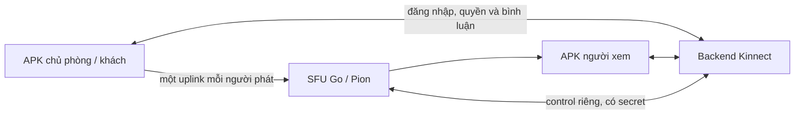

# Live cho APK Kinnect — SFU

Camera/game chỉ gửi một luồng media lên SFU. Người xem nhận từ SFU, nên thêm người xem không tạo thêm kết nối gửi video từ điện thoại chủ phòng. Tài khoản, quyền riêng tư, mời khách, bình luận và đếm mắt xem vẫn do backend Kinnect quản lý. Giao diện APK1.0.30 giữ nguyên; không sửa giao diện web trong đợt này.

## Giới hạn đã chốt

- **2.000 người xem/phòng,30 phòng đồng thời**, cấu hình server trong `sfu.env`.
- Chủ phòng + tối đa3 khách được lên hình như trước. Người xem không có quyền gửi media lên SFU.
- Đây là giới hạn cho phép tham gia, **không phải kết quả chứng nhận sức chứa**. Chưa thử2.000 máy hoặc30 phòng HD cùng lúc.
- Với giả định một luồng1,5Mbps,2.000 người xem cần khoảng3Gbps đầu ra/phòng;30 phòng đầy cần khoảng90Gbps, chưa gồm âm thanh, overhead, khách lên hình và lưu lượng TURN. Không thể suy ra máy PC hiện tại đáp ứng được chỉ bằng cách tăng giới hạn.

## Phần đã triển khai

- `services/live-sfu`: Go service, Pion WebRTC v4, codec VP8/Opus. Một upstream receive-only mỗi publisher, downstream send-only cho người đăng ký nhận. Không ghi media ra ổ đĩa, không mã hóa lại video.
- Control WebSocket chỉ mặc định lắng nghe loopback TCP7885, xác thực secret tối thiểu32 ký tự. Backend kiểm tra phiên đăng nhập, phòng, vai trò, block và revision trước khi chuyển signaling. Control đến máy khác bắt buộc WSS/TLS.
- UDP7886 dùng chung qua ICE mux; có STUN/TURN hiện hữu và cấu hình public IP cho VPS. Cloudflare tunnel hiện tại chuyển HTTP/signaling, không thay đường media UDP/TURN của SFU.
- Hủy kết nối hoặc thu hồi quyền lên hình làm đóng media session tương ứng. Control mất kết nối kết thúc phòng SFU liên quan; app hiện tại chờ SFU kết nối lại trước khi mở phòng mới; không âm thầm chuyển phòng đông người về mesh.
- Người vào/rời phòng không bắt chủ phòng khởi động lại uplink. Thay đổi người lên hình hoặc quyền block làm cập nhật revision và thu hồi media cũ.
- Danh sách avatar trong thông báo mắt xem chỉ gửi mẫu8 người; tổng số vẫn chính xác theo quyền block. Lấy block theo lô và gộp cập nhật danh sách phòng/mắt xem100ms, tránh truy vấn SQLite từng cặp người xem.
- Phiên bản legacy thiếu multiGuest không được vào phòng SFU. Chế độ mesh cũ giữ giới hạn6 người xem. App hiện tại đã hỗ trợ protocol cần thiết.

## Vận hành trên máy hiện tại

1. `node scripts/build-live-sfu.mjs`: xác minh Go modules, chạy kiểm tra và build binary. Go dùng bản có sẵn trong PATH hoặc `work/sfu-tools/go/bin/go.exe`.
2. File `sfu.env` riêng trên máy chủ có secret được sinh ngẫu nhiên; file thật và binary nằm ngoài Git. Xem mẫu `sfu.env.example`. Không đưa secret vào APK.
3. `node scripts/server-manager.mjs restart-server`: nạp cấu hình backend, giữ tunnel và SFU đang chạy.
4. `node scripts/server-manager.mjs restart-sfu`: khởi động lại riêng SFU, các phòng SFU đang phát sẽ bị ngắt.
5. `node scripts/live-sfu-status.mjs`: xem trạng thái, giới hạn, số phòng, upstream/downstream và heap SFU. Không in secret/SDP/cookie.
6. Đổi về mesh bằng `KINNECT_LIVE_TRANSPORT=mesh`, rồi restart backend. Giới hạn mesh vẫn6; tránh dùng mesh cho phòng đông.

Manager tự khởi động SFU ẩn trước backend, lưu PID và kiểm tra đúng tiến trình trước khi dừng. `stop` dừng cả SFU/backend/tunnel. Trong đợt triển khai này SFU ở cùng PC; máy chủ media chuyên dụng chưa được thuê hoặc cấu hình.

## Tách sang máy chủ media riêng

Có Dockerfile và Compose để chuẩn bị triển khai Linux; **chưa chạy Docker trên máy hiện tại**. Cần máy có IP/public networking và băng thông tương ứng, mở media UDP7886, giới hạn control ở mạng riêng hoặc qua WSS có TLS, và dùng cùng secret giữa backend và SFU.

- Build/chạy: `docker compose -f services/live-sfu/compose.yaml up -d --build` trên máy media đã chuẩn bị cấu hình riêng. Compose chỉ bind control vào loopback của máy media.
- Backend: đặt `KINNECT_SFU_MANAGED=remote`, `KINNECT_SFU_URL=wss://<control-private-host>/control`, cùng secret. Không xuất control plaintext ra Internet.
- Khi cần, đặt `KINNECT_SFU_PUBLIC_IPS` trên SFU thành public IPv4 của máy media. Kiểm tra cả Wi-Fi/4G, TURN fallback, reconnect, camera và game trước khi tăng tải thật.
- Hiện một backend kết nối một SFU; **chưa có cụm SFU phân phối phòng tự động**, Redis hoặc chuyển database sang PostgreSQL. Mục tiêu30×2.000 cần đo tải và thiết kế nhiều node/băng thông tương ứng; không xem cấu hình giới hạn là bằng chứng đã có hạ tầng đó.

## GPU và VRAM

Máy hiện tại có RTX3050,6GiB VRAM theo `nvidia-smi`. SFU đang chuyển tiếp RTP đã mã hóa nên không có tác vụ NVENC và không dùng VRAM để thay RAM hệ thống. GPU có thể phục vụ worker mã hóa/chuyển chất lượng video trong giai đoạn sau; chưa tích hợp worker đó. Không cộng VRAM vào dung lượng RAM cho kết nối/tài khoản.

## Kiểm chứng và phạm vi

- 110 kiểm tra backend trong `test/*.test.js` đạt, gồm SFU authorization, block, guest consent, revision, admission và hồi quy ứng dụng.
- Go: xác thực control và truyền RTP thực từ một upstream tới50 receiver giả lập đạt, thu hồi subscriber ngừng nhận. Payload thử nghiệm bitrate thấp; không phải benchmark50 luồng HD.
- APK1.0.30 nguyên bản (bản QA chỉ khác manifest/signature): camera native→backend xác thực với tài khoản riêng trong DB memory→SFU riêng→native viewer giải mã6 frames, kiểm tra publisher chỉ có một media connection. Không tạo phòng trên máy chủ công khai; chưa thử điện thoại thật hoặc nhiều mạng thực tế.
- Public health xác nhận SFU ready và giới hạn2000/30. APK download vẫn1.0.30; không đổi Play candidate hoặc web UI.

Tài liệu nền: [Pion WebRTC](https://github.com/pion/webrtc), [NVIDIA NVENC](https://docs.nvidia.com/video-technologies/video-codec-sdk/13.0/nvenc-video-encoder-api-prog-guide/index.html).
